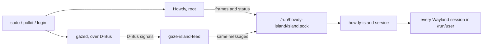

# howdy-island

A notch at the top of the screen that opens while your face is scanned, to log you in or to enrol
it, showing what the IR camera sees, mirrored so you know which way to turn. It works with either of
two face unlocks: [Howdy](https://github.com/boltgolt/howdy) or [Gaze](https://github.com/GunduLabs/gaze).


- Always there as a small notch glued to the top edge. It grows out of it while scanning, and its
  curves stretch as it comes out and squash as it goes back.
- Runs from boot as a system service, so it is also on the login screen and above the Hyprland lock
  screen.
- A small C program that talks Wayland directly (`wlr-layer-shell`). No GTK, no Python at runtime.
- On GNOME, which has no `wlr-layer-shell`, a GNOME Shell extension draws the same island.
- Leaves your Hyprland and sway configs untouched.

## Install

Arch-based distros (it uses `pacman` and `yay`), with an IR camera.

```bash
./install              # asks which face unlock: Howdy or Gaze
./install gaze         # or say it: howdy | gaze
./install --uninstall  # removes the island and the face unlock, package included
```

| | Howdy | Gaze |
| --- | --- | --- |
| A photo or a screen of you | may unlock it | rejected (liveness models on the RGB and IR images) |
| Enrolled faces | plain files | encrypted with the TPM |
| Runs on | dlib, built here (CUDA with an NVIDIA GPU) | ONNX Runtime; an Intel NPU if you say yes |
| The island shows the camera | while scanning and enrolling | while scanning (IR only) and enrolling |

Only one can be installed at a time. Installing one while the other is there asks to remove the
other first.

Both are added to `sudo`, `polkit-1` and `system-local-login` (which also covers the lock screens and
greetd) after the password: type it as usual, or press Enter on an empty prompt to use your face.
The installer finds the IR camera and enrols your face.

- **Howdy**: installs `howdy-git` and turns off its two text messages (`detection_notice`,
  `no_confirmation`): greeters that only answer the password prompt, such as nwg-hello on greetd,
  hang on them.
- **Gaze**: builds `gaze-island` (`gaze/package/`): Gaze's official package with `gazed` rebuilt
  from the same release plus `verify-preview.patch`, 8 lines that make it send the IR frames while
  scanning, as it already does while enrolling. It takes about 4 minutes and needs Rust; to update
  Gaze, bump `pkgver` and the checksums in the PKGBUILD and run the installer again. Then it sets
  the IR camera, turns on its IR liveness model and starts `gazed`. Gaze's text messages cannot be turned off, so nwg-hello, when installed, gets two lines
  that answer them (a pacman hook adds them again after each nwg-hello upgrade).
  With an Intel NPU it offers to download ONNX Runtime with OpenVINO (Intel's `onnxruntime-openvino`
  wheel, checked against its SHA-256) to `/opt/onnxruntime-openvino` and run the models there. If
  `gazed` does not start on it, it goes back to the processor.

Then, in front of the laptop (face unlock does not work over SSH):

```bash
sudo -k; sudo true
```

## Where it shows

| | Hyprland | sway, river, niri, labwc | GNOME | KDE Plasma |
| --- | --- | --- | --- | --- |
| `sudo`, polkit dialogs | yes | yes | yes, through the extension | should, untested |
| Lock screen | yes, above hyprlock | no | should, untested (GNOME only locks when run from GDM) | no |
| Login screen | yes, if the greeter runs on it | yes, if the greeter runs on it | no (GDM's greeter loads no extensions) | if the greeter runs on a wlroots compositor |

On a laptop it sits on the built-in panel, under the camera. A scan opens it only in the sessions of
the user being authenticated and on the login screen; everywhere else it stays a notch.

## How it works



- **Howdy**: `system/patch_hooks.py howdy` adds a few marked lines to Howdy's `compare.py`
  (authentication) and `cli/add.py` (`howdy add`) that send each analysed frame, the face boxes and
  the result to the socket. A pacman hook adds them again after every Howdy upgrade. Without the
  service listening, Howdy behaves as usual.
- **Gaze**: Gaze is a compiled program with no place for such lines, so `gaze/feed` is a small C
  service (`howdy-island-gaze.service`) that watches Gaze's D-Bus traffic as a bus monitor: who
  claims the daemon and for which user, then the face hints, the IR frames and the result. It
  sends them to the socket as the user Gaze authenticates for, so the island applies the same rules.
- `island/` is the service. It watches `/run/user/*` for Wayland sockets, connects to each
  compositor and draws the notch with cairo, at the screen's refresh rate while it moves and not at
  all while still.
- On Hyprland it adds an `above_lock` layer rule through the IPC socket at runtime, so the config
  file is never edited.
- On GNOME the service passes the scan on to `/run/user/<uid>/howdy-island.sock`, where the
  extension of that user listens. The installer puts the extension in
  `/usr/share/gnome-shell/extensions/` and adds it to your enabled extensions, leaving the others as
  they are; log out and back in to load it. Tested on GNOME 50.

The service runs as root to reach every user's Wayland socket, inside a strict systemd sandbox: no
network, read-only system, and only the capabilities needed to open those sockets.

Gaze sends its frames as D-Bus signals, which any local user can listen to: another account on
the machine could watch the IR camera while you authenticate. Gaze already does this while
enrolling; the patch extends it to scanning.

Any user may write to the socket, because a screen locker runs Howdy as the user instead of root.
The kernel tells the island who sent each message: a user can only show a scan of their own, and
only root (sudo, polkit, the login screen) reaches the login screen.

## Layout

| Path | What |
| --- | --- |
| `install` | the only script to run |
| `lib.sh` | shell helpers the install scripts share (IR camera, PAM lines) |
| `howdy/` | Howdy install script and its feed |
| `gaze/` | Gaze install script, its feed (`make -C gaze/feed`) and the patched package (`package/`) |
| `island/` | the C service (`make -C island`) |
| `gnome/` | the GNOME Shell extension and the script that enables it |
| `system/` | systemd units, pacman hooks and the line patcher they run |
