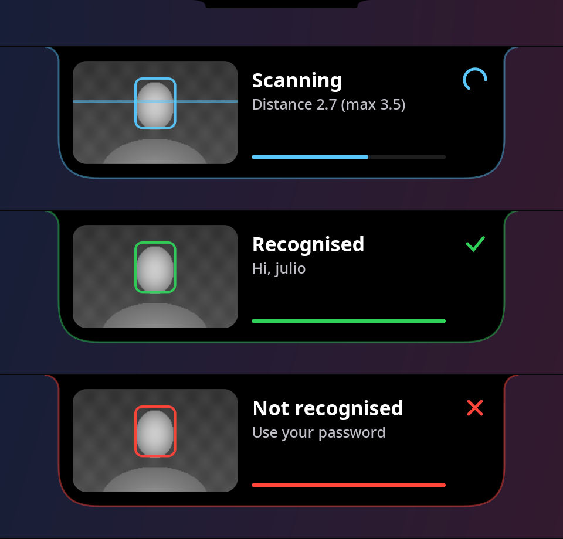
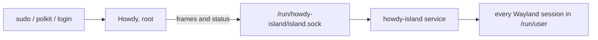

# howdy-island

A notch at the top of the screen that opens while [Howdy](https://github.com/boltgolt/howdy) scans
your face, to log you in or to enrol it with `howdy add`, showing what the IR camera sees, mirrored
so you know which way to turn.



- Always there as a small notch glued to the top edge. It grows out of it while scanning, and its
  curves stretch as it comes out and squash as it goes back.
- Runs from boot as a system service, so it is also on the login screen and above the Hyprland lock
  screen.
- A small C program that talks Wayland directly (`wlr-layer-shell`). No GTK, no Python at runtime.
- On GNOME, which has no `wlr-layer-shell`, a GNOME Shell extension draws the same island.
- Leaves your Hyprland and sway configs untouched.

## Install

Arch-based distros (it uses `pacman` and `yay`), with an IR camera.

```bash
./install              # Howdy, its PAM lines and the island
./install --uninstall  # removes the island and the PAM lines (the howdy package stays)
```

It installs `howdy-git` and builds `python-dlib` without CUDA unless there is an NVIDIA GPU, finds
the IR camera, enrols your face and adds Howdy to `sudo`, `polkit-1` and `system-local-login`.
The password comes first: type it as usual, or press Enter on an empty prompt to use your face.

Then, in front of the laptop (Howdy does not work over SSH):

```bash
sudo -k; sudo true
```

## Where it shows

| | Hyprland | sway, river, niri, labwc | GNOME | KDE Plasma |
| --- | --- | --- | --- | --- |
| `sudo`, polkit dialogs | yes | yes | yes, through the extension | should, untested |
| Lock screen | yes, above hyprlock | no | should, untested (GNOME only locks when run from GDM) | no |
| Login screen | yes, if the greeter runs on it | yes, if the greeter runs on it | no (GDM's greeter loads no extensions) | if the greeter runs on a wlroots compositor |

On a laptop it sits on the built-in panel, under the camera. A scan opens it only in the sessions of
the user being authenticated and on the login screen; everywhere else it stays a notch.

## How it works



- `howdy/patch_howdy.py` adds a few marked lines to Howdy's `compare.py` (authentication) and
  `cli/add.py` (`howdy add`) that send each analysed frame, the face boxes and the result to the
  socket. A pacman hook adds them again after every
  Howdy upgrade. Without the service listening, Howdy behaves as usual.
- `island/` is the service. It watches `/run/user/*` for Wayland sockets, connects to each
  compositor and draws the notch with cairo, at the screen's refresh rate while it moves and not at
  all while still.
- On Hyprland it adds an `above_lock` layer rule through the IPC socket at runtime, so the config
  file is never edited.
- On GNOME the service passes the scan on to `/run/user/<uid>/howdy-island.sock`, where the
  extension of that user listens. The installer puts the extension in
  `/usr/share/gnome-shell/extensions/` and adds it to your enabled extensions, leaving the others as
  they are; log out and back in to load it. Tested on GNOME 50.

The service runs as root to reach every user's Wayland socket, inside a strict systemd sandbox: no
network, read-only system, and only the capabilities needed to open those sockets.

Any user may write to the socket, because a screen locker runs Howdy as the user instead of root.
The kernel tells the island who sent each message: a user can only show a scan of their own, and
only root (sudo, polkit, the login screen) reaches the login screen.

## Layout

| Path | What |
| --- | --- |
| `install` | the only script to run |
| `howdy/` | Howdy install script, its feed and the patch that wires it to the island |
| `island/` | the C service (`make -C island`) |
| `gnome/` | the GNOME Shell extension and the script that enables it |
| `system/` | systemd units and the pacman hook |
